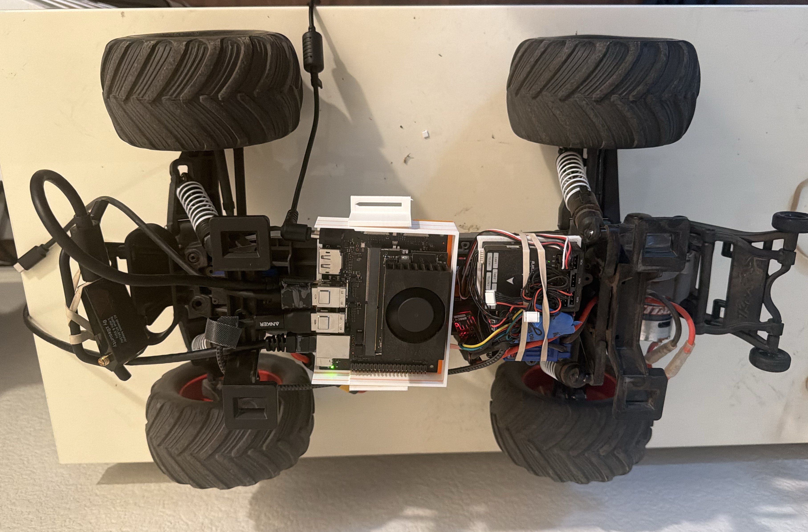

# Robo Bump Truck — how to build one

Author: [Colin Rooney](https://vaguebutexciting.dev/) · © 2026 Rooney Industries LLC

Build a phone-camera trail truck, print the cradle references, or follow the research that got it here. This repository records my physical truck and the practical choices behind it. The parts list and five phone-cradle reference files support a practical build with secure bands, straps and optional trays. Choose and check mounts for your own truck; exact historical compute/flight-controller carrier files are optional references. A reproducible powered controller package and full commissioning exports remain incomplete.

Recorded build, 2026-10-14: body removed; phone mount absent. The mounts and bands shown are reference choices; choose and check secure mounting for your own build.

[Watch the truck follow a trail (15 s video)](docs/img/field-run-trail-follow.mp4)

Start with the [system overview](docs/system.md) to see how the pieces connect, then pick the route that fits what you want to do.

| I want to… | Start here | Available outcome |
|---|---|---|
| Understand or assemble the physical truck | [Parts](docs/parts.md), [assembly](docs/assembly.md), then the sequence below | Historical mounting and wiring reference, with a [completion list](docs/assembly.md#build-completion-list); secure mounting choices and own-build fit checks; powered commissioning remains separate |
| Print the phone cradle | [Five cradle references](prints/phone-cradle/README.md) and [print guidance](docs/prints.md) | Four core parts and an optional shim; check your own fit |
| Try the public ROS interface | Upstream [build/tests](https://github.com/12mv2/robo-bump-truck-ros#build-and-test) and [outputs-disabled demo](https://github.com/12mv2/robo-bump-truck-ros/blob/main/truck_bridge/README.md#build-and-run) | Synthetic message delivery and shadow diagnostics, without a vehicle or model |
| Read the experiments | [Results](docs/research/results.md) and [method](docs/research/method.md) | Historical measurements, failures and corrections |

You do not need ROS to read the build, assemble unpowered parts or print the cradle. ROS setup and commands stay authoritative upstream. The [build checkpoints](docs/build-checkpoints.md) separate software demonstrations from powered commissioning. For a simple manual baseline, start with ordinary wheel steering and trigger throttle using the manufacturer instructions and a known-working truck/radio/receiver setup; an existing stock radio can do this before receiver changes. See [Start simple](docs/radio-and-controller.md#start-simple): the advanced MT12 research controls are optional. Manual use through Pixhawk still needs correct configuration and observed stopping; a commissioned public powered runtime is not supplied.

Independent fresh-follow validation of this guide remains pending after publication; no new build or powered acceptance pass is claimed.

## Project story and field reports

The [Vague but Exciting blog](https://vaguebutexciting.dev/) follows the experiments, setbacks and lessons behind this build:

- [Log 1 — I rearranged my kitchen to fool my robot](https://vaguebutexciting.dev/posts/kitchen-robot-eyes-log1/): the phone-bump experiment this project grew from.
- [Log 2 — My robot drove itself down a trail. Then it met a corner.](https://vaguebutexciting.dev/posts/robot-drove-itself-then-a-corner-log2/): early trail driving and the limits exposed by corners.
- [Log 3 — My robot lapped my kitchen on its own](https://vaguebutexciting.dev/posts/robot-lapped-kitchen-log3/): the indoor oval, camera timing and steering geometry.

These are dated field reports. Use the build instructions and checkpoints in this repository for assembly and commissioning requirements.

## Eventual physical build — historical reference

The physical build remains the goal. The sequence below preserves the build record; powered recipes require research/source-owner review and separate supervised bench/field acceptance. Read the [Orin boundary](docs/orin-setup.md) and [first-drive boundary](docs/first-drive.md) before using them.

1. [parts](docs/parts.md): expanded build materials, tools and spares, with connection requirements and own-build fit checks.
2. [prints](docs/prints.md): the printed parts, their fit and print profile; [assembly](docs/assembly.md) covers hands-on mounting and quick repairs, and [wiring connectors](docs/wiring-connectors.md) specifies the clean receiver harness.
3. [orin-setup](docs/orin-setup.md): set up the Orin that runs the steering.
4. [calibration](docs/calibration.md): steering centre and limits, camera pitch and height, camera intrinsics.
5. [radio-and-controller](docs/radio-and-controller.md): the radio's controls and the flight controller setup.
6. [power-and-safety](docs/power-and-safety.md): the supplies, the power-up order and the guards.
7. [first-drive](docs/first-drive.md): historical first powered-drive reference, gated before use.
8. [pitfalls](docs/pitfalls.md): what went wrong on this build, and the fix.

Then, as needed:

- [ros](docs/ros.md): the separate ROS 2 interface, and how the truck uses the Robot Eyes phone app.
- [data](data/README.md): planned sample-run descriptions and controller log format (downloads not yet available).
- [src/orin](src/orin/MANIFEST.md): the historical runs 27–31 Python snapshot, with a hash for every file.
- [model](model/README.md): the project's historical steering head, plus voluntary [community model links](model/community.md) (currently empty).

How the pieces connect is on [system](docs/system.md).

## Why it is built this way

**Train expensive, ship cheap.** The phone's expensive sensors do the teaching, and the historical deployed head reads camera pixels alone <!-- C:165-166 -->. There are two teachers, and each trained a different head <!-- C:154 -->. LiDAR depth taught the earlier phone-bump head where not to drive, as scaffolding only: "the trained head never sees depth" <!-- C:77-78 -->. The phone's ARKit pose taught the steering head, with no LiDAR and no human labels <!-- C:160-162 -->. The historical truck used a phone camera and that steering head (weights are not included), 385 parameters on a frozen DINOv2-S/14 backbone <!-- C:75-76, docs/reports/2026-10-02-model-identity.md:11 -->.

**Self-labelling.** The label comes from the act. In the phone-bump experiment the bump is the label <!-- C:26 -->: bump the phone body near an obstacle, the accelerometer marks when and LiDAR marks where, with no manual image labeling <!-- C:41, C:160 -->. 30 bumps gave 147,731 labeled patches over 927 frames <!-- F:216, C:50-51 -->. On the truck the driven path is the label: the steering head learns the curvature to a point 3 m along where the truck actually went <!-- C:160 -->, and in teach and repeat, laps driven by hand become the path the truck repeats <!-- F:1785 -->. Three referees grade the student; none of them draws a label: the ceiling camera, which never graded a whole lap <!-- C:427 -->; the pose grader, the phone's own track against a path driven by hand <!-- C:350, C:447 -->; and Colin, who designs the tests, drives and referees <!-- C:282-283 -->. The idea came from the [phone-bump experiment](docs/research/results.md#background-the-phone-bump-experiment-this-project-grew-from).

**Measured, not claimed.** No number goes on these pages until it is in the research record <!-- C:7 -->, and every number carries its source in a comment beside it. [Corrections](docs/research/corrections.md) lists each number or claim that was withdrawn or corrected, with the claim it reverses and the date <!-- C:745 -->. Being wrong is part of the work, and these pages say so plainly <!-- C:707, C:709-710 -->.

## What the truck does

A phone on the truck is its only perception sensor, and an Orin turns the phone's camera into steering <!-- C:163 -->. On a park trail, on camera alone, the steering head had the wheel for 99.6 s of a 212 s run; its longest stint covered the whole 18.4 m leg, and every hand-back was at a turnaround <!-- F:2410 -->. On an indoor tape oval it ran teach and repeat: three laps driven by hand became the taught path <!-- F:1785 -->, and with that path and the camera together 15 of 24 lap segments ran at full steering-head authority, against 2 of 14 for the camera alone <!-- F:1790 C:780-782 -->. With the camera starved on purpose, a return mode brought the truck back to the taught path: three laps with no human input, worst excursion 0.26 m <!-- F:1854 -->. Recovery of a stuck truck is not shown yet: reversing did not free a wedged truck <!-- F:2084 -->. The limits are on [cannot-do-yet](docs/research/cannot-do-yet.md).

## Research record

- [results](docs/research/results.md): what the truck did, every number with its instrument, day and caveat.
- [method](docs/research/method.md): how each number was measured.
- [corrections](docs/research/corrections.md): numbers and claims withdrawn or corrected, and why.
- [cannot-do-yet](docs/research/cannot-do-yet.md): what the truck has not been shown to do.

## Licence

- Code: MIT, © 2026 Rooney Industries LLC ([LICENSE](LICENSE)).
- Data and photos: CC BY 4.0 ([data/LICENSE](data/LICENSE)). Attribution: Colin Rooney, Rooney Industries LLC.
- Third party: the DINOv2-S/14 backbone is Apache-2.0; its licence and copyright notice are kept with it. The attribution is in [model/NOTICE](model/NOTICE).
