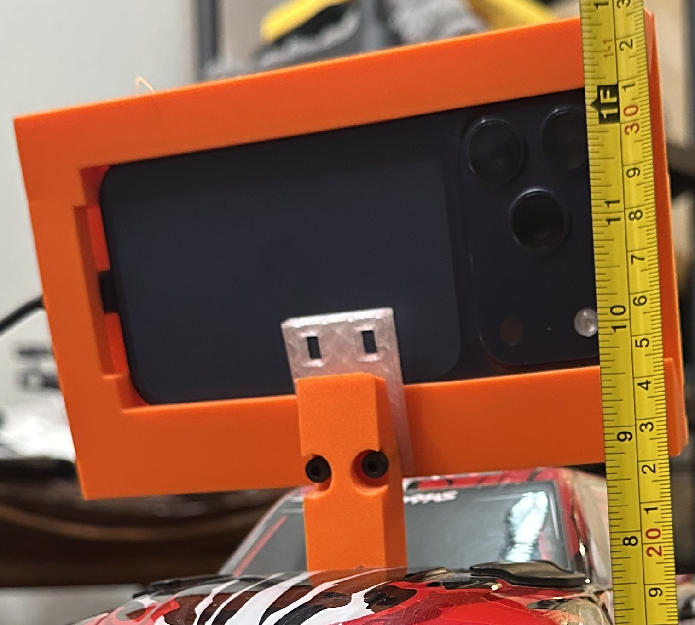

# Calibration

Author: Colin Rooney · © 2026 Rooney Industries LLC · MIT licence

This page covers the three things on this truck that had to be measured before steering and the camera could be trusted: the steering servo's centre and limits, the camera's pitch and height, and the camera's intrinsics. Each section says what the value is, how it was found, and what went wrong on the way. The values belong to this truck and this phone. Measure your own; do not copy them.

Historical measurements, nominal display scale and computed distances are distinguished below. The instruments and graders are on [method](research/method.md).

## Own-build measurement checklist

Before physical commissioning, record the following for the assembled build; use the [controller boundary](first-drive.md) before any powered measurement:

- Loaded, settled floor-to-lens-centre height for the active camera, with units and load state.
- At-rest camera pitch below the horizon and lens offset ahead of the rear axle, including measurement references.
- Steering straight-ahead centre, both safe endpoints and actual left/right direction without linkage binding; recheck after linkage or radio changes.

The snapshot defaults `--cam-h` to 0.26 m, while the later recorded height below is 0.29 m; `--cam-fwd` defaults to zero despite the recorded 0.24 m offset. <!-- src/orin/live_trail.py:239,1393,1405-1408 --> The intended configuration needs source-owner reconciliation with your measurements. Neither defaults nor historical numbers are prescriptions for a new controller; this page supplies no new settings.

## Steering: centre and limits

| Item | Value | How it was found |
|---|---|---|
| Servo centre (straight ahead) | 1463 µs <!-- F:971 C:458 --> | The truck's real straight, moved from the default of 1500. |
| Full lock | 1826 µs one way, 1100 µs the other <!-- F:3041 --> | The servo output was logged on every drive in one night and stayed inside 1100–1826 µs. |
| Servo maximum | 1826 µs <!-- F:971 C:630 --> | Set so the travel is equal either side of centre: 363 µs each way <!-- F:971 C:630 -->. |
| Command tracking | median difference 68 µs <!-- F:3041 --> | Logged servo output against the commanded PWM, within one frame. |

A builder who assumes a centre of 1500 steers wrong on this truck. The centre is a property of the linkage as built, so find it on your own truck before setting any limit.

### What went wrong

Moving the centre from 1500 to 1463 left 437 µs of travel one way and 363 µs the other <!-- F:971 C:627-629 -->. Only the longer side could be commanded past the steering linkage's mechanical stop. The symptom, hand-driving at crawl speed, was steering that froze in whatever position it was in for about three seconds and released when the driver stopped <!-- C:625-627 -->. A fresh battery pack changed nothing <!-- C:627 -->.

Lowering the maximum from 1900 to 1826 made the travel 363 µs each way <!-- F:971 C:630 -->. Stops of 0.6 s or longer went from 11 in 193 s to 3 in 140 s across one drive before and one after <!-- F:972 C:630-632 -->. That is not a controlled comparison: the two drives differed in length and speed. It was also one cause, not the only one. The freeze list in the log held full lock the other way and dead centre as well <!-- F:982-983 C:633-634 -->.

Rule for builders: when you move the centre, re-derive both limits from it in the same sitting.

## Camera pose: pitch and height

The phone sits on a cradle above the cab. A thin shim between the TRAY and RISER changes the pitch; the foot/T-bar joint is separate. All pitches below are degrees below the horizon.

| Mount | Measured pitch (deg below horizon) |
|---|---|
| Normal | 19.7–20.1 <!-- F:323 --> |
| Wedge-down | 24.5 <!-- F:323 --> |
| Wedge-up | 14.4–14.7 <!-- F:323 --> |

Historical front detail, 2026-09-12, approved by the author as a mounting reference. This image does not establish a fitted shim, lens height or camera pitch. For the separate tray/riser and foot/T-bar joints, see the [cradle assembly schematic](img/cradle-assembly.svg) and [assembly directions](../prints/phone-cradle/README.md#assembly).

Pitch was recovered from the pose quaternion the phone reports. At three pairs of sessions it resolved a 5° wedge: the nominal thin wedge is 5°, and the measured wedge came out at 4.5–5.4° <!-- F:323 -->, an independent check on the print. Roll stayed within 2° of level <!-- F:323 -->. An A/B of the three mount angles, two sessions each, found no difference in pose output <!-- F:324 -->, so none of the three is recommended over another on that evidence.

An October 6/7 mount-check sequence also recorded wedge-up: the ground/shocks-extended readback had median pitch 15.8974°. This is camera pose, not a 15° shim identification; the exact October shim marking was not recovered.

### Lens height

On September 14, after spring spacers, the upper/main wide lens was ruler-measured at 0.290 m above the ground with the truck loaded and settled <!-- F:1941, F:1947 -->. The calibration images give the same answer on their own: 0.29–0.31 m, against 0.29 m measured with a ruler <!-- F:1941 -->.

The height changed once. On 2026-09-03 the lens was measured at 260 mm, not the roughly 300 mm first assumed <!-- F:400 -->. From 2026-09-14 it is 290 mm, after spring spacers raised the truck <!-- F:1941, F:1947-1948 -->. Look-ahead scales linearly with height <!-- F:400 -->, so any ground distance computed from a height belongs to the height it used.

The September 12 tape-backed forward offset is 0.24 m ahead of the rear axle (and 0.06 m left); older 203 mm/254 mm-derived entries are stale. The later field kit retained auxiliary-camera `cam-fwd` 0.24 m while its perception node saved 0.25 m: these are different layers, not interchangeable measurements. The historical loaded height is already documented; builders still measure their own assembled geometry.

### Pitch sets how far the camera sees

With the lens at the earlier 0.26 m, the centre of the band the steering head reads lies at these ground distances <!-- F:802 -->. These are computed from that height and the measured pitch, not measured on the ground; at 0.29 m each distance is longer in the same proportion <!-- F:400 -->.

| Mount | Band reach (m) |
|---|---|
| Wedge-down | 0.98 <!-- F:802 --> |
| Normal | 1.42–1.48 <!-- F:802 --> |
| Wedge-up | 2.97–3.17 <!-- F:802 --> |

A 2 m look-ahead fits only the wedge-up mount <!-- F:802 -->.

### What went wrong: the pitch moved

The phone's at-rest pitch at launch read 9.2–10.8° on every launch one night, against 16.4–17.6° on every recorded drive before that night; same phone, same mount by the driver's account <!-- F:3043 -->. The camera feed agreed: the far floor line sat about 55 px lower in a 350 px frame, roughly 9° of tilt in the same direction <!-- F:3043 -->. After the phone was re-seated, the on-screen readout showed 16.0° at rest <!-- F:3043 -->, but the driver still reported poor steering, and the cause was not resolved <!-- F:3043 -->.

Check the at-rest pitch at every launch, and compare it with the value from the last good drive before you read anything into the steering.

## Camera intrinsics: a worked example

The camera intrinsics are the focal lengths, the principal point and the lens distortion coefficients. This example is the rear camera of an iPhone 17 Pro, calibrated on 2026-09-21 <!-- F:2556 F:2773 --> at a desk <!-- F:2551 -->, with a checkerboard shown on a computer screen and the phone hand-held against it <!-- F:2608 F:2773 -->.

Session `331317298d` used ARKit capturedImage frames at 1920×1440, with 9×7 internal corners (10×8 squares). The recorded nominal square size is 37.825 mm: a 27-inch 2560×1440 display with 162 px squares gives 37.8248803 mm by its nominal diagonal. No ruler measurement or capture-time display scaling confirmation was recovered. Intrinsics K and distortion D fits are invariant to this board scale; board distance and extrinsics require the actual square size.

The fit used 124 detected views <!-- F:2631 -->. Three distortion models were fitted to the same views, and each was then checked by fitting on 62 views and measuring on the other 62 <!-- F:2631 -->.

A low reprojection error does not prove the focal length is right: see [pitfalls](pitfalls.md#low-calibration-error-wrong-focal-length).

| Distortion model | rms reprojection error (px) | Correction at the frame corner (px) | Corner value, stability across the split |
|---|---|---|---|
| plumb_bob, free k3 | 0.266 <!-- F:2636 --> | +92.0 <!-- F:2636 --> | ±18% <!-- F:2636 --> |
| plumb_bob, k3 fixed | 0.490 <!-- F:2637 --> | −46.2 <!-- F:2637 --> | ±37% <!-- F:2637 --> |
| rational_polynomial | 0.196 <!-- F:2638 --> | +12.9 <!-- F:2638 --> | ±5% <!-- F:2638 --> |
| Factory lens table | n/a | +16.2 <!-- F:2639 --> | n/a |

The rational model is the preferred fit. It tracks the factory curve, where both plumb_bob fits run off in opposite directions <!-- F:2641 -->. At the corner it sits 12.9 px against the factory 16.2 px <!-- F:2638 F:2639 -->. That is a finding about these polynomials, not about polynomials in general.

### The files

| File | Distortion model | Image size | Use |
|---|---|---|---|
| [camera_info-rational.yaml](calibration/camera_info-rational.yaml) | rational_polynomial | 1920×1440 <!-- yaml header --> | Preferred. |
| [camera_info-rational-160x120.yaml](calibration/camera_info-rational-160x120.yaml) | rational_polynomial | 160×120 <!-- yaml header --> | The same fit for a consumer that runs on a 160×120 frame. |
| [camera_info-plumb_bob.yaml](calibration/camera_info-plumb_bob.yaml) | plumb_bob | 1920×1440 <!-- yaml header --> | Only if your tool cannot read the rational model. |
| [camera_info-plumb_bob-160x120.yaml](calibration/camera_info-plumb_bob-160x120.yaml) | plumb_bob | 160×120 <!-- yaml header --> | The same fallback at the small size. |

Each file is a ROS camera_info document. Scaling to 160×120 scales the focal lengths and the principal point with the width; the distortion coefficients are dimensionless and are unchanged, so scaling does not reduce the error.

### What went wrong, and what to watch for

1. Full coverage of the capture grid hid a gap. The 4×4 coverage score was 1.0, yet only 4 of 7,812 detected corners, 0.05%, lay beyond 0.80 of the frame-corner radius, and the furthest reached 0.858 <!-- F:2625-2628 -->. Past about 0.86 of that radius every model is extrapolating <!-- F:2625-2628 -->. Keep to the region the board covered, and do not rectify full frames with the plumb_bob fallback.
2. The factory table does not belong on these frames. ARKit already corrects the image it returns, imperfectly <!-- F:2551 -->. Applying the factory table on top moved the residual bow from −0.182 px to −0.447 ± 0.022 px: it corrects twice <!-- F:2622-2623 -->.
3. Zero coefficients were being recorded. The recorder wrote zero distortion in every rear-camera session, because all three writers read a front-camera-only data source <!-- F:2482 -->. In those sessions the distortion is recorded as zero, not measured.
4. A low rms alone does not validate a fit. The two best fits above differ by 0.07 px of rms <!-- F:2636 F:2638 --> and by about 79 px of correction at the frame corner <!-- F:2636 F:2638 -->. Check behaviour across the radius, and on views held out of the fit, before trusting the number.

The four supplied YAMLs do not record checkerboard square size. Before a new calibration, measure the actual displayed or printed square size, record its unit and the capture image resolution, and identify the camera/image pipeline. These YAMLs are historical examples, not your phone calibration.

To repeat this on your own phone: record a checkerboard at varied tilts, detect the corners, fit with `cv2.calibrateCamera`, and hold out half the views <!-- F:2631 -->. Put the board near the edges and corners of the frame, not only in the middle.
