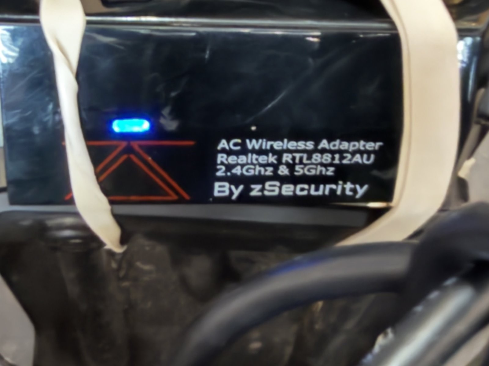
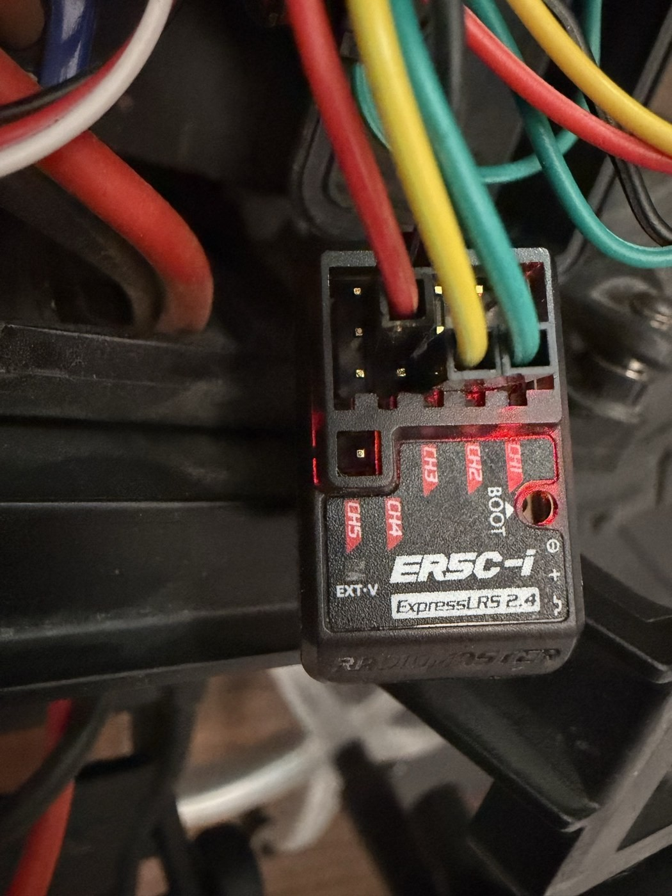

# Parts

Author: Colin Rooney · © 2026 Rooney Industries LLC · MIT licence

This combines the recorded truck's fitted/owned parts with required build materials and recommended repair supplies. Choose materials to suit your assembly and check what your bundle includes. Fitted claims describe the historical build; ownership alone does not establish installation. Some items came with the truck or controller bundle and are not extra orders.

Historical list and paid prices below retain their source comments and dates; no new price is inferred. Unpriced means no supported price is recorded. Read [mounting and repairability](assembly.md), [clean receiver wiring](wiring-connectors.md) and [prints](prints.md) alongside this list. Five [phone-cradle reference print files](../prints/phone-cradle/README.md) are supplied; historical compute/FC carrier files are optional references and are not supplied here. Full commissioning assets remain outstanding.

## Status and remaining fit details

Shopping actions use these labels throughout: **included/check bundle**, **buy separately if missing**, **required for selected procedure**, **optional**, **recommended**, and **unresolved**. Check what you have before ordering. The role/detail columns preserve what was actually used or owned; a shopping action is not evidence of historical ownership. Unknown quantities stay unknown.

| Remaining detail | What is still needed |
|---|---|
| Mount retention | Choose secure bands/straps and optional trays/supports to suit your truck. Historical assorted-fastener and band counts remain unknown; no fixed count or exact standoff shopping list is prescribed. |
| Cable connections | Match data capability, end genders, pinout and polarity; provide slack and strain relief on a route of your choice. Recorded lengths are references, not required routes. |
| Charging and radio power | Identify the actual compatible traction charger and chosen MT12 battery arrangement. The supported transmitter options are listed below; the fitted historical pack is not identified. |
| Mount/fastener stack | Check the selected mount and phone fit. Tray/riser uses two M4 bolts. The author's approximate shim-bolt recollection is 20–25 mm: consider that range, then verify actual engagement, head/washer fit and no phone contact; fit is not guaranteed. Check the body-post interface only if using the reference T-bar. |

The [build checkpoints](build-checkpoints.md) retain separate software, configuration and powered-acceptance gaps. Use the [public ROS setup/build guide](https://github.com/12mv2/robo-bump-truck-ros#build-and-test) for host tools and dependencies. Robot Eyes stays closed source; phone/app access is a separate prerequisite on the [ROS connection page](ros.md#robot-eyes-the-phone-app).

## Parts list

| Part | Role | Qty | List price | As of | Link | Paid (receipt) | Shopping action |
|---|---|---|---|---|---|---|---|
| Traxxas Stampede 2WD HD (36254-8) | The chassis | 1 | $229.95 with battery and charger <!-- F:154, B17b:35 --> | 2026-10-10 | [traxxas.com](https://traxxas.com/36254-8-stampede-2wd-xl-5-wbattery) | none | buy separately if missing |
| Traxxas XL-5 speed controller | Drives the motor; its built-in 1 A regulator feeds the steering servo rail <!-- C:613-617, F:713 --> | 1 | unpriced | none | none | none | included/check bundle |
| Traction pack, 7-cell NiMH, Traxxas connector <!-- F:3117, INV:17 --> | Powers the drive; 8.4 V on the label <!-- F:3133 -->, 9.33 V fresh <!-- F:3117 --> | not recorded (sold with the chassis <!-- F:154 -->) | unpriced | none | none | none | included/check bundle |
| Holybro PM02 V3 power module | Sits inline on the pack and feeds the flight controller only, not the servo rail <!-- F:713, F:2344 --> | 1 | unpriced | none | none | included in the bundle price <!-- F:306, B10:7 --> | included/check bundle |
| TRX-to-XT60 adapters (male and female, both ways) | Put the power module inline on the pack <!-- F:2344, INV:71 --> | not recorded | unpriced | none | none | none | buy separately if missing |
| Holybro Pixhawk 6C Mini | Flight controller, running ArduPilot Rover <!-- F:306, F:733 --> | 1 | unpriced | none | none | $191.09 for the bundle with the power module, plus shipping <!-- F:306, B10:7 --> | buy separately if missing; check PM02 bundle |
| RadioMaster MT12 Surface (EdgeTX, ExpressLRS) | The [operator radio](radio-and-controller.md) <!-- F:665 --> | 1 | $129.99 <!-- B17b:40 --> | 2026-10-10 | [radiomasterrc.com](https://radiomasterrc.com/products/mt12-surface-radio-controller) | none | buy separately if missing; check receiver bundle |
| RadioMaster ER5C-i ExpressLRS receiver | Receives the operator radio; on the flight controller's TELEM1 port <!-- F:814, F:2344 --> | 1 | $19.99 <!-- B17b:41 --> | 2026-10-10 | [radiomasterrc.com](https://radiomasterrc.com/collections/all/products/er5c-i-2-4ghz-elrs-pwm-receiver) | none | buy separately if missing; fitted ER5C-i differs from ER3C-i bundle |
| NVIDIA Jetson Orin Nano Super 8 GB | The truck's compute: JetPack 6.2.1, L4T R36.4.7 <!-- F:745 --> | 1 | unpriced | none | [NVIDIA kit information](https://developer.nvidia.com/embedded/jetson-developer-kits); [historical retailer](https://www.microcenter.com/product/691058/Jetson_Orin_Nano_Super_Developer_Kit) <!-- B10:9 --> | $219.99 before tax, on an exchange receipt <!-- B10:9 --> | buy separately if missing |
| INIU USB-C PD power bank | Isolated supply for the Orin; it ran about 4 h in one session <!-- F:3133 --> | 1 | unpriced | none | none | none | buy separately if missing |
| USB-C PD to DC cable, 15 V, 5.5×2.5 mm, recorded 4.9 ft | Bank to Orin; verify polarity and bank PD profile before substituting <!-- F:871; INV: compute --> | 1 | unpriced | none | none | none | buy separately if missing |
| USB wireless adapter, Realtek RTL8812AU chipset | The Orin's WiFi, taped to the front bumper <!-- INV:62 -->; out-of-tree driver, no DKMS <!-- F:1373 --> | 1 | unpriced | none | none | none | buy separately if missing |
| iPhone | Camera and ARKit pose sensor <!-- F:320 --> | 1 | unpriced | none | none | none | buy separately if missing |

## Connections, storage and charging

These additional categories are unpriced; quantities are not established unless stated in the historical table. Check the delivered bundle before ordering duplicates. An included item missing from your actual bundle becomes a separate purchase; the historical list does not promise current retail contents.

| Material | Shopping action | Build detail |
|---|---|---|
| Stock drive motor, steering servo and XL-5 ESC | included/check bundle | Included with truck; required. Reuse the truck's installed drivetrain/control parts. No separate motor or servo purchase is implied; exact motor/servo replacement models are not established here. |
| Compatible traction-pack charger and charge lead | included/check bundle | Required; chassis listing includes battery/charger. Match the 7-cell NiMH chemistry, pack voltage and Traxxas connector. Verify the actual charger supplied. Traxxas↔Tamiya charging adapters were owned; use only if the chosen charger needs them, with polarity checked. <!-- INV: cables --> |
| MT12 transmitter batteries and USB-C charging supply/cable | buy separately if missing | Required; batteries not included with radio. [RadioMaster specifies](https://radiomasterrc.com/products/mt12-surface-radio-controller) two 18650 cells or a compatible 2S 7.4 V pack and built-in USB-C charging (checked 2026-10-16). The historical fitted battery is not identified; AA ownership does not establish an MT12 power option. |
| PM02-to-flight-controller power/sense lead | included/check bundle | Required; recorded with module. Six-pin module lead to the FC POWER port. Check it is in the delivered bundle; PM02 powers the FC, not the servo rail. <!-- INV: flight control --> |
| Both TRX↔XT60 power adapters | buy separately if missing | Recorded used; required for this pack/module combination. Adapter on each side of PM02: Traxxas pack → module → XL-5. Confirm mating genders and polarity; do not buy two identical ends by accident. <!-- INV:71; F:2344 --> |
| Four-wire receiver harness | buy separately if missing | Required; finished adapter missing from author's bundle. Six-position GH1.25 to four individual female 2.54 mm sockets, pins 1/2/3/6. Spare GH lead was available; soldered prototype was used. Prefer the [preterminated specification](wiring-connectors.md). |
| Steering and ESC three-wire leads | included/check bundle | Recorded used; required. Steering to MAIN1, XL-5 to MAIN3 with its BEC feeding the servo rail. Existing component leads may suffice. Servo extensions were owned; add only for routing reach, not as a fixed extra count. <!-- INV: power domains/cables --> |
| NVMe boot storage | required for selected procedure | Recorded used; required for recorded Orin setup. Historical underside evidence identifies a nominal 256 GB Inland TN320; [Orin setup](orin-setup.md) records a 233 GB root disk. Capacity/usable space differ; no prepared boot image is supplied. |
| Phone and session storage | required for selected procedure | Required for live-phone/recording path. Compatible phone with app access plus free phone and Orin space for sessions/logs. Size to the intended recording duration; no universal capacity is established. |
| PD-bank charging supply/cable | required for selected procedure | Required to recharge chosen bank. Match the bank's charging specification. A phone/USB charger being available does not establish that it negotiates the bank's required profile. |
| Phone-to-Orin USB **data** cable | required for selected procedure | Required for recorded stream. Match the particular phone's connector (USB-C or Lightning as appropriate) and available host port; a charge-only cable will not do. Do not assume every phone variant uses the same end. |
| Flight-controller-to-host USB **data** cable | required for selected procedure | Required for recorded FC connection. USB-C at this FC; choose the matching host end. This is separate from the phone cable and can keep the FC powered after pack removal. |
| RTL8812AU USB WiFi adapter and Ethernet recovery cable | required for selected procedure | WiFi recorded used; Ethernet recorded in kit. Keep cable recovery access available. A host Ethernet dongle is recommended if the setup computer lacks a socket; it is not a claimed fitted truck part. |
| USB right-angle adapters/short extensions | optional | Owned; optional routing aids. Recorded Type-A right-angle adapters and 1 ft USB extension can reduce awkward routing. Check clearance and data support; a hub is not a required fitted part. <!-- INV: cables --> |

The current MT12 ExpressLRS listing includes an ER3C-i receiver; this build uses the separately listed ER5C-i. Check the actual bundle contents rather than assuming it contains that receiver. [RadioMaster MT12 contents](https://radiomasterrc.com/products/mt12-surface-radio-controller) (checked 2026-10-16).

## Mounting materials and tools

| Material/tool | Shopping action | Practical role |
|---|---|---|
| Compute tray/clamp and FC carrier | optional | Historical reference designs; files are not supplied. Secure bands/straps with suitable supports are a normal alternative; see [mount checks](assembly.md#build-completion-list). |
| Phone tray/riser, T-bar and retaining pin | required for selected procedure | Four core cradle references supplied; historical versions on [prints](prints.md). Check selected geometry and phone fit before dependent purchases. |
| Single historical 5° shim | optional | Fifth cradle file; only if wanted, between tray and riser. Choose length by actual stack engagement and phone clearance. |
| Bolts, nuts, washers, standoffs and appropriate body-mount hardware | required for selected procedure | Choose only what your mount uses. Cradle joint quantities are below; historical assortment and body-post counts remain unknown. No universal standoff or band count is prescribed. |
| Insulating pad/card | required for selected procedure | Required where the mount needs electrical separation. Insulating card appears in the historical mounting plan; exact fitted material/thickness is not established. Keep conductors clear of supports and other boards. |
| Reusable straps/hook-and-loop, rubber bands | buy separately if missing | Straps owned; bands actually used and preferred. Retain removable assemblies and batteries appropriately. Follow [assembly](assembly.md) and the FC-specific retention constraints, not a band across its top servo rail. |
| Gaffer tape and painter's tape | optional | Actually tried. Useful temporary mounting/label/repair materials; prototype wiring ended in blue tape. Do not depend on tape to establish a correct electrical connection. |
| Soldering iron and solder | required for selected procedure | Actually used for the DIY prototype; needed only if selecting soldered construction/repair. Tiny-wire work was unpleasant. The correct terminated harness is preferred over recreating that adapter. No used brand or tip specification is established. |
| Fine tip, flux, heat-shrink, wire strippers, helping hands and hot air | recommended | Recommended repair tools/materials. Useful if repairing wiring; these are recommendations, not a claimed historical tool inventory. Hot air is not a prerequisite for a correctly terminated harness. |
| Multimeter | required for selected procedure; recommended for repair | Required for the DIY harness's unpowered continuity/short/polarity checks; generally recommended as a repair tool. Historical records explicitly lacked a meter at some checks; no claim of historical ownership. |
| Metric hex drivers, cutters and ruler | required for selected procedure | Assembly tools; hex wrench recorded in kit, other tools recommended. Match the actual fastener heads; cut consumables and measure chosen routes/fit. |
| Calibration board/target and ruler | required for selected procedure | Required for chosen camera-calibration procedure. Follow [calibration](calibration.md); confirm physical square size/display scaling rather than treating a nominal display calculation as a measurement. |
| Printer access, slicer and PETG | required for selected procedure | Required to make selected mounts; five cradle references available. Recorded profile: 0.4 mm nozzle, six walls, gyroid; orientations and fit limits on [prints](prints.md). Fit-critical coupons answer the fit question before a full part. |

### Recorded cradle joint quantities

| Joint | Quantity and reference | Verification still needed |
|---|---|---|
| Tray/riser, flat or single optional shim | 2 M4 bolts + 2 washers + 2 captive M4 hex nuts; 16 mm hole spacing | v26 flat nominal 22.2 mm before washer supports M4×25 as a reference only. Verify head style, washer, engaged thread and tail clearance in the actual stack. For a shim the author recalls approximately 20–25 mm; consider that candidate range and verify the actual stack, adequate engagement and no phone contact. Fit is not guaranteed. |
| Riser foot/T-bar | 2 M4×16 bolts + 2 washers + 2 wing nuts, recorded reference | Verify clearance and engagement as built. |
| T-bar/body-post pair | Hardware and count not established | Identify front or rear attachment through the shell opening and verify the actual interface. |
| Phone retention | 1 standard v21b two-notch pin, 4.2 × 2.85 mm section | Fit gently; verify phone fit and retention separately from screen, camera and USB clearance. |

See the [cradle package](../prints/phone-cradle/README.md) for orientations and bolt direction. These quantities describe the chosen reference cradle; alternative mounts need their own fit checks. No fresh fit acceptance is claimed.

## Repair spares and optional equipment

The owned stock springs and body latches below are historical spares, not upgrades. Recommended field repair supplies include spare bands/straps/tape, a replacement phone-retaining pin, selected printed mount/wedge spares, compatible servo leads and checked power/USB adapters. Exact quantities are not established.

GPS, additional cameras, jump-test kicker and a standalone BEC upgrade are **optional changes/research equipment**, not claims about what was fitted or required purchases for the historical baseline. The recorded XL-5 1 A servo supply has a known weakness; listing an optional BEC does not claim that weakness is resolved or waive later commissioning. Y-splitter leads were owned for a possible BEC change, not required by the recorded wiring.

Adapter mounting close view, 2026-09-24: the adapter, pale retaining strips and bumper tubes are visible. This is not a whole-front view or evidence of the current assembly. Image credit: Colin Rooney, Rooney Industries LLC, [CC BY 4.0](../data/LICENSE).

ER5C-i label and pin markings, 2026-09-19. This identifies the historical part; confirm the intended receiver and wiring during commissioning. Image credit: Colin Rooney, Rooney Industries LLC, [CC BY 4.0](../data/LICENSE).

## Wheelbase

wheelbase: Traxxas spec 270 mm (https://traxxas.com/36054-8-110-stampede-xl-5-2wd-monster-truck-with-tq-radio; https://traxxas.com/36254-8-stampede-2wd-xl-5-wbattery, read 2026-10-10); measured 277.5 mm on this truck. The deployed controller does not use it; pure pursuit uses only the camera offset ahead of the rear axle, 0.24 m (src/orin/live_trail.py:2635 at f6ff42a, every run plan). <!-- spec: Traxxas pages linked inline; 277.5 mm: author's tape, 2026-10-10; 0.24 m: S:76, C:507 -->

## Historical stock springs

White STOCK 3758X front and 3757X rear springs were explicitly recorded on the truck on September 12, as well as in the spare bag. Extra pairs are spares, not stiffness upgrades. September 14 spring spacers changed the loaded height; no later spring replacement or exact spacer stack is established.

## Owned spares and body interface

| Part | Qty | List price | Shopping action |
|---|---|---|---|
| Traxxas 3619X body mount latches <!-- INV:44 --> | not recorded | unpriced | optional spare |
| Extra Traxxas 3758X front springs (white) <!-- INV:41 --> | not recorded | unpriced | optional spare |
| Extra Traxxas 3757X rear springs (white) <!-- INV:42 --> | not recorded | unpriced | optional spare |

The 3619X rear latch crossbar had a recorded interim camera/platform body-interface role. The T-bar spans a front or rear body-post pair through a shell opening, not a chassis slot. Ownership of spare 3619X latches does not identify which purchased set was fitted, or identify every black support block.

## Notes

| Item | Note |
|---|---|
| Springs | The 3758X and 3757X springs are stock for this chassis, not upgrades <!-- INV:41 -->. |
| Orin unit | The unit's exchange receipt is dated 2025-11-22; its purchase date is unconfirmed <!-- B10:9, B10:30 -->. |
