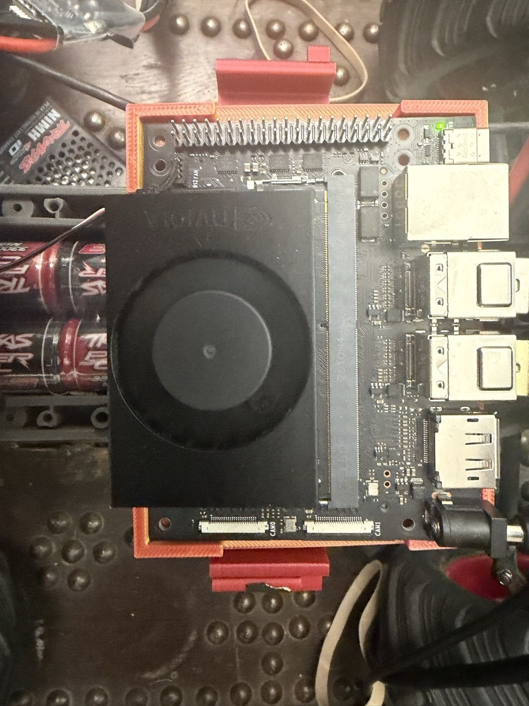
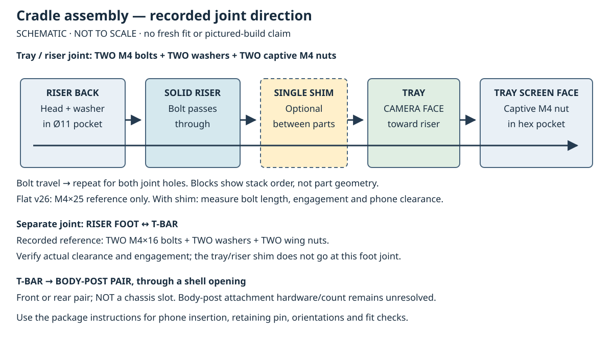

# Printed parts

Author: Colin Rooney · © 2026 Rooney Industries LLC · MIT licence

This page records the historical print roles, version claims, fit observations and print profile. Five phone-cradle reference STLs are now supplied in the [cradle package](../prints/phone-cradle/README.md). Historical compute/FC carrier files and generators are not supplied here; these are optional reference designs, not universal kit deliverables or publication prerequisites. Secure band/strap retention with suitable supports is a normal alternative. Proposed CAD or a newer filename does not identify a fitted part or prove fit on another build. The recorded compute-tray v0 and clamp v7 claims below are retained as historical claims, not new fitted proof; the available top views do not resolve the clamp underside/version. The recorded cradle release is v26 tray/riser, v66 T-bar and v21b standard two-notch pin. Release and bench records identify the design; they do not establish which revision remained fitted later.

For removable assemblies and repair access, see [hands-on mounting guidance](assembly.md). For any selected mount, protect the board, fan and connectors: the FC sandwich retains around the board, with no band/strap across the top servo rail or upward leads. Keep its USB/SD and telemetry connectors accessible. The cradle package recovers joint diameter and quantities; the selected shim bolt length still needs physical verification.

## The prints

| Print | Version | Role | Fit facts |
|---|---|---|---|
| Compute tray | v0 | Carries the compute board on the clamp. | Corner brackets stand proud of the board edge; the board holes are empty. |
| Clamp | v7 | Red strap-ear clamp under the chassis. Holds the compute tray on the chassis rail. | Snaps over the rail; a 72.0 mm cavity fitted the rail, 73.5 mm left about 1.5 mm of play <!-- F:456 -->. v6 and v7 differ only in the orientation of the pack pocket on the underside. |
| Flight-controller tray | v1 | Holds the flight controller. | First article needed a pocket correction (see below). |
| Cradle tray and riser | v26 release | Holds the phone above the cab. | Recorded release and bench assembly direction recovered; the revision fitted later has not been established. |
| Standard pin | v21b, two-notch | Retains the phone in the tray. | Standard middle-pin selection recorded; another phone still needs fit acceptance. |
| T-bar | v66 | Cross bar between the cradle post and the truck. | Spans the body-post mount, front or rear pair, with a hole cut in the shell for the mount to pass through <!-- F:402 -->. Foot joins with a bolt, washer and wing nut, so it opens without tools <!-- F:421 -->. |
| Wedge | nominal 5° historical shim | Tilts the phone mount. Use a single appropriate shim. | Sits between TRAY and RISER, separate from the foot/T-bar joint. September 2 reference; October wedge-up does not recover the exact shim marking. |
| Body-post interfaces | exact black-block identity unresolved | Supports at the body-post positions. | Stock HD interface records name 3614X front sockets and 3619X rear bars; top views do not identify every block. No required printed body-post-riser file is established. |
| Kicker | k100-10 v1 design | Optional jump-test apparatus, not a prerequisite for a first ordinary drive: printed ribs under a hardboard deck. | Four plate files and a joint coupon exist externally; no completed print, coupon fit or assembled-deck acceptance recovered. |

Compute board, tray and clamp from above, 2026-09-19. Confirm the underside fit and installed print version separately. Image credit: Colin Rooney, Rooney Industries LLC, [CC BY 4.0](../data/LICENSE).

This schematic explains the recorded joint stack, not the appearance or fit of a completed build. If using the reference T-bar, check its actual body-post interface and attachment hardware; see the [build completion list](assembly.md#build-completion-list). Unknown historical block identity does not prevent alternative secure mounting.

The abandoned, never-printed `post_v0.stl` is a 10×10×22 mm electronics-carrier spacer beside the battery, not a body-post riser. The October compute-tray v2 proposal is unprinted and is not adopted here.

## What had to be corrected

The flight-controller tray was the clearest case of a fit correction. Its first article was printed and tried on the board: the pocket was drawn 59.0 x 40.0 mm against a board measuring about 57 x 38 mm, and the pocket needed 1.0 mm taken off on both axes <!-- F:695 -->. The cavity had been sized to the larger vendor figure on purpose, so the correction came from holding the printed part against the real board, not from the drawing. The trim lives in a separate correction constant in the generator, never in the board dimensions.

## Print profile

| Item | Setting |
|---|---|
| Nozzle | 0.4 mm <!-- F:424 --> |
| Material | PETG <!-- F:458 --> |
| Wall loops | 6 <!-- F:424 --> |
| Infill | Gyroid <!-- F:424 --> |
| Support | Support-free design aim; inspect slicer islands, bridges and overhangs for the actual orientation and printer before printing |
| Brim | On tall or thin footprints, optional on large flat faces |

Recorded orientations: tray screen-face down, riser on its back, wedge flat, pin thin side down. Check the selected source before slicing; older tall foot-down instructions are stale.

The recorded tray/riser joint uses two M4 bolts at 16 mm spacing, two washers and two captive M4 hex nuts. Heads and washers sit in the riser back Ø11 pockets; bolts pass through solid riser, optional single shim and tray camera face into the nuts in the tray screen face. The riser's 20° face mates to the tray camera face, with the phone camera toward the riser and down. The deeper camera groove determines insertion direction.

M4×25 remains a brief flat-joint reference, not a universal bolt length. For the single shim, the author recalls approximately **20–25 mm** bolts; this is an approximate recollection and a practical candidate range, not a measured fit guarantee. Check the actual head/washer fit, solid stack, adequate thread engagement, no bottoming and no phone contact. Choose length by the actual assembly; do not prescribe 20 mm for every wedge or change geometry to solve a bolt stack.

The foot/T-bar joint records two M4×16 bolts, two washers and two wing nuts; verify as-built clearance and engagement. If using this T-bar, check the actual body-post hardware; the historical hardware/count remains unknown. Follow the [package assembly instructions](../prints/phone-cradle/README.md#assembly).

## How the parts were made

The historical parts were made from generator scripts with a scripted pre-print check (watertight, bed fit, overhang limits). Fit-critical features were first printed as small coupons and tried on the truck. A coupon that fits outranks the tape measure. A coupon result settles that one fit only, so any new part that grips the same rail carries its own coupon <!-- F:456 -->.

## Files

The [phone-cradle package](../prints/phone-cradle/README.md) supplies exactly five ASCII reference files: individual v26 tray and riser, v66 T-bar, standard v21b pin and historical v10 5° shim. They use design millimetres and are individual objects in design coordinates, not print plates; orient them in the slicer. Print one of each core part and one shim only if wanted. The pin is the standard two-notch 4.2 × 2.85 mm section; fit gently. The package records the historical phone envelope and requires separate phone-fit, screen, camera and USB clearance checks.

No compute/FC truck-carrier files, generators or combined plates are supplied. The optional kicker reference is `kicker_k100-10_plate1_v1.stl` through plate4 and `kicker_joint_coupon_v1.stl`; alternative k125-25 files also exist externally but generation proves no assembly. Preserve the remaining fitted-identity limits: no fresh print/fit/strength acceptance is claimed, and the exact later fitted revision is unknown. Do not infer a fitted version from proposed CAD or purchase dependent hardware on an unverified fit.

Related: [parts list](parts.md) · [assembly and repairability](assembly.md) · [pitfalls](pitfalls.md)
