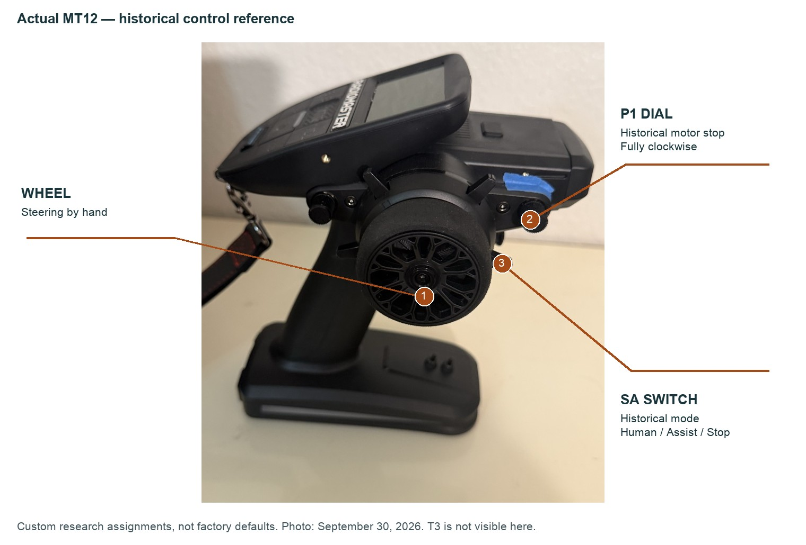

# Radio and controller: bind, set up, drive

Author: Colin Rooney · © 2026 Rooney Industries LLC · MIT licence

Start with ordinary wheel steering and trigger throttle in a known-working manual setup, then decide whether to add research controls or Orin autonomy. The historical configuration below records that later research setup; it is not a complete recipe for a new controller. Before powered commissioning through the flight controller, read the [first-drive/source-owner boundary](first-drive.md). The intended controller needs source-owner review and separate supervised bench/field acceptance.

## Start simple

Use the truck, radio and receiver manufacturer instructions to establish ordinary wheel steering and trigger throttle with a known-working manual setup before introducing Orin autonomy or custom research mixes. An existing stock radio can establish this baseline before receiver changes. MT12 users should follow the compatible receiver and binding instructions for their equipment.

That manual baseline does not establish compatibility between factory receiver PWM output wiring and this build's TELEM1 serial receiver connection. Manual use through Pixhawk still requires correct firmware/configuration, verified direction and endpoints, and observed neutral/stop behaviour under the intended conditions. Keep the flight-controller stop and commissioning checks below; changing the radio does not bypass them.

Mounting and the public [outputs-disabled ROS interface](ros.md) can proceed without advanced radio controls. Neither establishes powered commissioning.

## Advanced historical research configuration

The SA/P1/T3 controls, independent wheel/trigger copies and custom mixes below are optional research configuration, not a universal physical-build prerequisite or a supplied turnkey profile. All control numbers, wiring, binding, power-up, driving and troubleshooting actions in the remaining sections belong to that historical configuration. This record maps each control to the label printed on the radio. Every other page names a control by what it does ("the mode switch", "the kill dial", "the speed dial"); come here to find it on the radio. Each number carries its source line, and how the numbers were measured is on [method](research/method.md).

The radio is a RadioMaster MT12 Surface running EdgeTX with an ExpressLRS link (see [parts](parts.md)). Its receiver feeds the flight controller; the Orin sends its steering and throttle to the same flight controller, and the radio can override it <!-- F:2976 -->. The whole signal path is on [system](system.md).

Historical controls, 2026-09-30: annotations identify this build's research functions, not a factory profile or current stopping acceptance. The underside speed trim (T3) is hidden; the [controls table](#controls-by-function) remains the authority for functions and locations.

## Missing commissioning inputs

Full firmware, flight-controller parameter, EdgeTX model/mixer and binding exports are NOT SUPPLIED by this repository. Historical fields are partially known to the project; this is a delivery and commissioning gap, not a claim that those fields are all unknown. Reconcile the complete exports with the intended controller owner before powered checks:

- Exact flight-controller firmware/version and parameter export; flight-controller system identity and permitted sender identity.
- Receiver protocol, physical port and verified channel/output mapping, including independent wheel/trigger copies and steering/throttle outputs.
- EdgeTX model/mixes, binding procedure and compatible radio/receiver firmware; receiver and flight-controller failsafe behaviour.
- Kill, manual override and override-expiry behaviour, including loss of link, loss of intent and process failure.
- Supervised armed/disarmed and one-control-at-a-time channel observations: neutral, direction, endpoints, mode and kill responses, without unintended cross-mixes.
- Separate drive, servo, flight-controller/USB and compute power paths and full isolation, as listed on [power and safety](power-and-safety.md#commissioning-and-isolation).

Pass observations must come from the new setup, including demonstrated motor neutral/stop under the intended conditions; the historical six-cycle kill result below is not acceptance. Wheel override is steering only, not a guaranteed motor stop. Lane loss, stale intent and `route_end` can leave speed-dial throttle in the supplied snapshot. Historical operating rules and guards do not close that blocker. <!-- src/orin/owner_simple.py:51-56,110-142; src/orin/live_trail.py:2872-2883 -->

Dated field records include mode CH3, kill CH5, independent wheel copy CH4, trigger copy CH10 and speed dial CH9; RC steering/throttle CH1/CH2 and reported servo1/servo3. Startup records include sender identity gate 255, override timeout about 0.3 s and RC5_OPTION 31. These partial records do not replace full exports or new-build one-control-at-a-time observations.

The separate October 8 powered field kit is not distributed here. Its transmitter-loss and stale-image gaps remain open; see the canonical [field-kit details](ros.md#how-it-connects-to-the-orin-stack).

## Controls by function

The embossed labels on the radio are hard to read in normal light, so the truck's radio carries label tape <!-- R:3 -->. Look up the function here, then read the label off the radio. The printed labels appear only in this table.

| Function | Printed label | Where on the radio | What it does |
|---|---|---|---|
| The wheel | Handwheel | Right side, foam wheel | Steers. Its measured centre is 1485 µs, not 1500 <!-- F:732, R:12 --> |
| The trigger | Trigger | Under the grip | Throttle. Any pull by hand overrides the speed dial's throttle <!-- F:2976, R:13 --> |
| The mode switch | SA | The one grey lever around the wheel that stays where you set it; three positions | Selects who drives (see [the mode switch](#the-mode-switch)) <!-- F:732, F:2399, F:1311, R:14 --> |
| The kill dial | P1 | Knob on the right of the wheel housing | Stops the motor when turned fully clockwise; runs when fully counter-clockwise <!-- F:825, F:2399, F:735, R:15 --> |
| The steering-source dial (retired) | P2 | Knob on the left of the wheel housing | On the earlier blend forwarder this set who steered: low end you, high end the steering head <!-- F:2399, F:1311 -->. The deployed owner does not read it <!-- F:2976, S:47, R:16 --> |
| The speed dial | T3 | Trim under the radio | Sets the cruise throttle; at the bottom it is itself a stop <!-- F:1793, F:2399, F:2401, R:17 --> |
| The throttle trim | T1 | Trim on the wheel housing | Trims the trigger's rest; leave it alone <!-- F:903, R:18 --> |
| The steering trim | T5 | Spring-back lever around the wheel | Trims the steering <!-- F:904, R:19 --> |

## Wiring and servo setup

These are recorded receiver and output facts for the historical build. Resolve the checklist above before applying any wiring or servo setting.

| Item | What to do or expect |
|---|---|
| Receiver port | Wire the receiver to the flight controller's first telemetry port (TELEM1). On the second port (TELEM2) the 5 V pin did not power the receiver; the cause was not diagnosed <!-- F:814 --> |
| Throttle lead | Put the speed controller's throttle lead on MAIN 3. On a receiver pin that carries serial data, not servo pulses, the speed controller's LED stayed red, its "no valid neutral" state <!-- F:865 --> |
| Servo straight | Straight ahead is 1463 µs, not 1500 <!-- F:971, C:458 --> |
| Servo limits | Full lock is 1100 to 1826 µs. With the upper limit at 1900 the servo had 437 µs of travel one way and 363 µs the other; setting it to 1826 gave 363 µs both ways <!-- F:971, F:3041, F:1077, C:610, C:629-630 --> |
| Steering direction | A higher servo PWM turns the wheels left. Reproduced from pose over 1,199 samples <!-- F:818, F:1078 --> |

For the proposed cleaner TELEM1-to-receiver connection, use the [four-wire harness specification and pin mapping](wiring-connectors.md). It is separate from the XL-5 servo-style three-pin lead on MAIN3 and steering on MAIN1. The XL-5 BEC supplies the servo rail; PM02 supplies the flight controller only. Do not add an ESC/BEC receiver supply alongside TELEM1 power. The proposed replacement harness has not been fitted/tested.

The servo numbers and how they were found are on [calibration](calibration.md).

See the [historical receiver label detail](img/receiver-label-2026-09-19.jpg) for component identification and the [recorded wiring diagram and exact endpoint table](wiring-connectors.md#specify-the-ends-and-every-connection) for connections. The label image does not verify the TELEM1 harness.

## Bind and power-up

**Power-up order.** Radio on, then pack in, then Orin on. The flight controller boots from the pack, so the receiver boots with the pack, and the receiver must see the radio first <!-- F:2346, F:717 -->.

**Binding.** Binding is done by power-cycling the receiver in a short sequence. Each powered interval in the sequence must be about 1 s; longer than about 2 s resets the receiver's power-cycle counter <!-- F:673 -->. This record does not hold the number of power cycles or the radio-side steps; follow the [ExpressLRS binding documentation](https://www.expresslrs.org/quick-start/binding/) for those, and use the interval above.

**Pack pull.** Pulling the pack while the Orin is up no longer kills the flight controller, because USB still feeds it, but it drops the servo rail <!-- F:2346 -->. This follows from the wiring.

**Receiver in WiFi mode.** A receiver powered for about 60 s with the radio off drops into WiFi mode. The flight controller then sees zero channels and reports a radio failsafe, with all its serial settings correct, and rebooting the Orin does not help <!-- F:1141 -->. Use the complete [receiver power cycle](power-and-safety.md#receiver-power-cycle): both pack/module and USB can feed the FC/receiver, so unplugging USB alone is insufficient. The recovery off interval is separate from the rapid binding timing above. <!-- F:1141, F:2346 -->

## The mode switch

The mode switch has three positions and stays where you set it <!-- F:732, F:2399 -->. Its three positions are named by function, and the name alone does not say who is driving <!-- R:33, R:35 -->.

| Position | Operator name | Software mode |
|---|---|---|
| Far end (left) | Human | Human: the Orin sends nothing <!-- R:33, F:2976 --> |
| Middle | Shared | Assist: the steering head steers, and a wheel or trigger pull overrides <!-- R:33, F:2976 --> |
| Near end (right) | Kill | Stop <!-- R:33, F:2976 --> |

These names are Colin's labels, not a measurement <!-- R:33 -->. Check the actual owner of the controls before assuming help is active.

**On the earlier blend forwarder, two controls decided who steered.** On 2026-09-11 every run had the mode switch in the middle band and the steering-source dial at its low end, and the radio steered, not the steering head <!-- F:1296, C:713, C:715 -->. The next night the steering head steered five times, each with the mode switch in the same middle band and the steering-source dial at its high end <!-- F:1311, C:723 -->. The dial decided, not the state name in the log <!-- C:723 -->. The deployed owner does not read this dial <!-- F:2976, S:47 -->.

## Driving

| Control | What to expect |
|---|---|
| The wheel | Steers by hand; a turn of the wheel overrides the steering head's steering <!-- F:2976, R:12 --> |
| The trigger | Throttle. Throttle followed the trigger whenever the kill dial was released, and a held trigger did not defeat the kill dial <!-- F:826 --> |
| The kill dial | Fully clockwise stops the motor; fully counter-clockwise runs <!-- F:825, F:735, R:15 --> |
| The speed dial | One click is about 134 µs on the radio channel and about 15 µs of throttle in the 1625 to 1725 µs band <!-- F:1793 --> |

**The kill dial under load.** With the rear wheels off the ground, the trigger held near full pull, and the truck armed, every move of the kill dial to stop snapped the speed controller's output to neutral within one sample. It held there while the trigger stayed pinned, and it did so on all six cycles <!-- F:826 -->. Half-way in its notch the dial flickers between run and kill (36 flips in 30 s) and stops the motor <!-- F:1793 -->. Set it fully to one end. A knob is an acceptable stop for the bench and for supervised runs; replace it with the plug-in switch module before anything faster than walking pace <!-- F:825 -->. Kill paths are on [power-and-safety](power-and-safety.md).

**The speed dial at the bottom.** The bottom of the speed dial is itself a stop <!-- F:1793, F:2401 -->.

**A disarmed flight controller ignores the trigger.** With the flight controller disarmed, the throttle output stayed at neutral while the trigger moved through its range <!-- F:2398 -->. If the throttle does not respond, check the armed state first.

**Steering reads while software overrides.** While the software overrides steering, the flight controller reports the override value back, so a radio steering reading in the log is not the wheel <!-- F:2160 -->.

## Trims and mixes

| Control | Finding |
|---|---|
| The throttle trim | 45 clicks moved the trigger's rest from 1476 to 1376 µs. It caused a reverse whine and would have made the arming guard refuse at the next start. Zero it <!-- F:903 --> |
| The steering trim | About 1.5 µs per click, too fine to feel by hand <!-- F:904 --> |
| A stray mixer line | A mixer line added the mode switch into the throttle. It was deleted; after that, only the trigger moves the throttle <!-- F:868 --> |

After you edit the radio's mixes, move each control once and confirm that only the intended output changes.

## Historical autostart and the bench

Historical autostart is not supplied. On the recorded truck, keep AUTO_OFF present on the bench and before another phone-stream client starts; the phone serves one client. See [autostart and the pause file](orin-setup.md#autostart-and-the-pause-file) for boot, arming and service details. <!-- F:2970, F:2976, F:2978 -->
