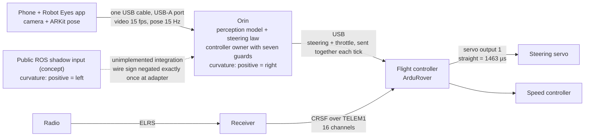

# System: how the pieces connect

Author: Colin Rooney · © 2026 Rooney Industries LLC · MIT licence

This page covers the truck as one system: the components, what each one sends to the next, at what rate, and which way a positive steering number turns the wheels. Read it before [power-and-safety](power-and-safety.md) and [first-drive](first-drive.md). Each number carries its source line. How the numbers were measured is in the [research record](research/method.md).

## The diagram

**Historical DINO truck architecture.** Solid arrows show that historical drive path. The dashed public-shadow input is an **unimplemented integration concept**, not an actual drive edge.

| Path | Historical use | Available here |
|---|---|---|
| Bundled runs 27–31 DINO snapshot | Historical truck controller | Source snapshot; local backbone/head dependencies and full configuration/acceptance remain outstanding |
| Public ROS shadow bridge | Never actuates; has not driven the truck | Separate public interface and outputs-disabled diagnostics; no vehicle output path |
| Separate October 8 powered field kit | Historical powered use, manually launched | Not distributed; complete source package, rebuild instructions, exports and new-build acceptance outstanding; known transmitter-loss gap |

The [field-kit explanation](ros.md#how-it-connects-to-the-orin-stack) records its command lifetime, throttle authority and stale-image limits.

[System diagram as an image](img/system-diagram.svg)
<!-- phone to Orin: C:240-241 (one USB cable), F:3100, F:872, C:244-245 (USB-A), F:2412, C:209-213 (15 fps), F:1349 (pose 15 Hz). Orin to flight controller: F:3100 (USB), F:2976, B49 (steering and throttle sent together each tick). Radio to receiver to flight controller: F:730, F:733 (ELRS, CRSF), F:814 (receiver on TELEM1, 16 channels). Servo straight: F:971. Seven guards: F:2976. Signs: C:401-406, S:130, S:247. ROS bridge has not driven the truck: ROS:README.md:9-10, ROS:README.md:20 -->

See the [body-off truck image](../README.md) for the 2026-10-14 physical arrangement, with the phone mount absent. Its mounts and bands are reference choices, not a universal mounting requirement.

## Phone and Robot Eyes

The phone is the only perception sensor <!-- C:163 -->. The Robot Eyes app streams camera frames and the phone's ARKit pose to the Orin.

| Item | Value |
|---|---|
| Capture underneath | ARKit runs at 60 Hz (59.976 Hz) <!-- F:574 --> or 30 Hz <!-- F:927 --> |
| Video to the Orin | 15 fps; the app recomputes its frame divider every second from the measured capture rate <!-- F:2412, C:209-213 --> |
| Pose to the Orin | 15 Hz on the same stream; 12.6 Hz unique pose when capture is at 30 fps <!-- F:1349, F:2412 --> |

How the truck uses the app (power-up order, session handling) is on [ros](ros.md).

## The cable

The video reaches the Orin over one USB cable: no capture card, no WiFi, no radio link <!-- C:240-241 -->. The Orin enumerates and pairs with the phone using stock packages <!-- F:512 -->. On a bench indoors the link ran 30 min, 27,000 frames, with zero stalls and zero disconnects at 15.02 fps <!-- C:241-242 -->. Outdoor heat is a separate question <!-- C:246-247 -->.

For this build, connect the phone to one of the Orin's USB-A host ports. In the recorded setup, the phone was not detected through USB-C <!-- F:3100, F:872, C:244-245 -->. That is a result for this setup, not a universal USB-C limitation: [NVIDIA's hardware guide](https://docs.nvidia.com/jetson/orin-nano-devkit/user-guide/latest/hardware_layout.html#usb-ports) lists host, device and recovery modes for USB-C, while the four USB-A sockets are host-only. Whether this build's cable powers or charges the phone has not been measured <!-- C:243-244 -->.

Glass-to-application delay of the camera stream is about 60 ms, an upper bound <!-- C:230-231 -->. How it was measured is in the [research record](research/method.md#latency-rig).

## Orin

The Orin runs the perception model, the steering law and the controller owner.

**The perception model.** A frozen DINOv2-S/14 backbone sees each frame resized to 476×350, and a logistic steering head of 385 trained parameters reads its features <!-- C:75-78 -->. The head trains in about 2 min, fully locally <!-- C:77 -->. At run time it sees RGB features only <!-- C:77-78, C:163 -->. Its labels come from ARKit pose alone, as the steering law's curvature to a point 3 m along where the truck actually went: no LiDAR and no manual image labeling <!-- C:158-160 -->.

**The steering law** turns a goal point ahead of the truck into a curvature. It assumes coordinates measured from the rear axle, and the lens sits 0.24 m forward of it, so the code applies that offset <!-- S:76, S:78-79, C:507-510 -->.

The wheelbase is 270 mm by the Traxxas spec ([Stampede XL-5 2WD](https://traxxas.com/36054-8-110-stampede-xl-5-2wd-monster-truck-with-tq-radio), [Stampede 2WD XL-5 with battery](https://traxxas.com/36254-8-stampede-2wd-xl-5-wbattery), read 2026-10-10), and 277.5 mm measured on this truck. The deployed controller does not use it: pure pursuit uses only the camera offset ahead of the rear axle, 0.24 m (src/orin/live_trail.py:2635 at f6ff42a, every run plan). <!-- spec: Traxxas pages linked inline; 277.5 mm: author's tape, 2026-10-10; 0.24 m: S:76, C:507 -->

**The controller owner.** The owner decides what reaches the flight controller. A separate output thread re-checks every guard from fresh radio and flight-controller telemetry on each tick and sends steering and throttle together; a steering-head request older than its hold time steers centred, never held <!-- F:2976; B49 -->. The guards are listed on [power-and-safety](power-and-safety.md).

Historical autostart is not supplied or adopted as a current controller. On that truck, AUTO_OFF pauses it on the bench and before another phone client starts; see [Orin service history](orin-setup.md#autostart-and-the-pause-file). <!-- B8 probe 2026-10-10; B49; F:2970 -->

**Software stack**, read from the truck's Orin on 2026-10-10 <!-- B8 probe 2026-10-10 -->:

| Layer | Version |
|---|---|
| L4T / JetPack | 36.4.7 / 6.2.1 <!-- B8 probe 2026-10-10 --> |
| OS | Ubuntu 22.04.5 <!-- B8 probe 2026-10-10 --> |
| Python | 3.10.12 <!-- B8 probe 2026-10-10 --> |
| ROS 2 | Humble <!-- B8 probe 2026-10-10 --> |
| PyTorch | 2.8.0, CUDA available, CUDA 12.6 on the Orin GPU <!-- B8 probe 2026-10-10 --> |
| TensorRT | 10.3.0 <!-- B8 probe 2026-10-10 --> |
| Power mode | 25 W <!-- B8 probe 2026-10-10 --> |

## Flight controller, servo and speed controller

The flight controller runs ArduRover and drives the steering servo and the speed controller. The steering servo's straight-ahead pulse on this truck is 1463 µs, not 1500 <!-- F:971 -->. Setting it is on [calibration](calibration.md).

## Radio

The radio reaches the flight controller through its receiver: radio, ELRS, CRSF, TELEM1, flight controller <!-- F:733, F:814 -->. The receiver is wired to TELEM1: TELEM2's 5 V pin did not power it <!-- F:814 -->. After the move to TELEM1 the flight controller saw 16 channels <!-- F:814 -->. Mode switching was checked earlier, with the receiver on TELEM2: a dozen clean transitions <!-- F:733 -->.

| Control | What it does |
|---|---|
| The [mode switch](radio-and-controller.md) | Picks the mode: far end human, middle assist, near end stop <!-- S:47 --> |
| Wheel or trigger | Wheel overrides steering only; trigger takes throttle while touched <!-- S:47 --> |
| The speed dial | Throttle <!-- S:47 --> |
| The kill dial | The kill, at the flight controller <!-- S:47 --> |

First use of the radio with the truck is on [first-drive](first-drive.md).

## Sign convention

Positive curvature is a right steer. <!-- C:401-406, S:130 -->

| Where | Positive curvature means |
|---|---|
| Truck controller | Right <!-- C:401-406, S:130 --> |
| ROS 2 wire (`control_cmd`) | Left; adapter conversion negates it exactly once <!-- S:247, ROS:docs/seam-sign-convention.md:3-5, ROS:docs/seam-sign-convention.md:8-9 --> |

The public ROS shadow bridge has not driven the truck and cannot actuate. The separate field kit did have historical powered use. The sign rule and path distinction are on [ros](ros.md).

## Where to go next

| Page | Covers |
|---|---|
| [calibration](calibration.md) | Steering numbers and camera pose on the truck |
| [radio-and-controller](radio-and-controller.md) | The radio's controls and the flight controller setup |
| [power-and-safety](power-and-safety.md) | Supplies, power-up order, the guards |
| [first-drive](first-drive.md) | The first drive, step by step |
| [pitfalls](pitfalls.md) | What went wrong and how to avoid it |
| [ros](ros.md) | The ROS 2 interface and Robot Eyes |
| [prints](prints.md) | Printed parts |
| [data](../data/README.md) | The sample data |
| [research record](research/INDEX.md) | What the truck did, and how each number was measured |
