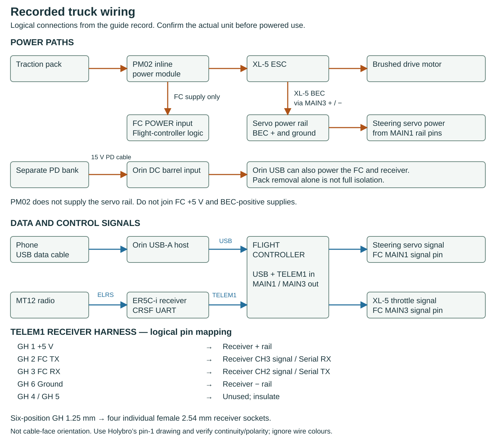

# A cleaner receiver harness

Author: Colin Rooney · © 2026 Rooney Industries LLC · MIT licence

Tiny-wire soldering was fiddly and unpleasant; my prototype ended up in blue tape. My Pixhawk bundle lacked the finished receiver adapter, although a spare GH lead was available. Box contents vary: that does not mean Holybro supplies no cables. A correctly preterminated harness is the preferred improvement. No replacement described here has been fitted or electrically tested.

## Specify the ends and every connection

Recorded-build power and control connections: this is a logical diagram, not cable-face orientation or measured current continuity. Use the endpoint table and manufacturer pin-1 drawing below, then check the actual harness. The historical taped harness is not a newly fitted or tested version of the cleaner replacement proposed here.

For this recorded Pixhawk 6C Mini / ER5C-i setup, specify **one six-position JST-GH, 1.25 mm pitch plug to four individual female 2.54 mm receiver-header sockets**, wired to GH positions 1, 2, 3 and 6. Choose routing length after laying out the assembly.

| TELEM1 GH position | Flight-controller function | ER5C-i endpoint |
|---|---|---|
| 1 | +5 V receiver supply | + rail |
| 2 | FC TX, 3.3 V signal | CH3 signal: receiver Serial RX |
| 3 | FC RX, 3.3 V signal | CH2 signal: receiver Serial TX |
| 4 | CTS | Unused; insulate |
| 5 | RTS | Unused; insulate |
| 6 | Ground | − rail |

Use [Holybro's pin-1 orientation diagram and port pinout](https://docs.holybro.com/autopilot/pixhawk-6c-mini/pixhawk-6c-mini-ports). Looking into a socket versus at a cable reverses the apparent order. Neither wire colours nor the word “JST” identifies a correct cable: GH is not SH, DF13 or PicoBlade.

[ArduPilot's CRSF guide](https://ardupilot.org/rover/docs/common-tbs-rc.html) calls for crossed TX/RX on a full UART; [ExpressLRS serial documentation](https://www.expresslrs.org/software/serial-protocols/) explains serial output configuration. CH2 TX / CH3 RX is this receiver's recorded configuration, not a universal ELRS channel assignment. Verify receiver labels and configuration.

Use **TELEM1** for this build. Older TELEM2 instructions and photos predate the recorded move after its 5 V pin failed to power the receiver; the cause remained undiagnosed.

## Keep the ESC lead separate

The XL-5's servo-style three-pin lead belongs on **MAIN 3**, providing throttle signal and BEC power to the servo rail. Steering goes on **MAIN 1**. The PM02 feeds the flight controller only, not that rail. Orin USB can additionally power the flight controller and its receiver; removing the traction pack alone does not isolate them. Do not also power the receiver from the XL-5 BEC when TELEM1 supplies its + rail. The receiver UART harness and ESC lead serve different jobs; see [radio/controller](radio-and-controller.md).

## What to buy, and what does not quite fit

Ask a harness supplier for the specification and mapping above, with individually housed receiver sockets. Proper precrimped contacts/leads are another route; confirm terminal/housing compatibility without soldering tiny adapter wires.

One candidate is [BeyondRobotix GH–DuPont, variant 52265886548305](https://www.beyondrobotix.com/products/jst-gh-telem-cable?variant=52265886548305). At the October 16 research capture it was out of stock. Its pictured receiver end is one four-position block, whereas these endpoints need separate sockets. It needs depinning/rehousing after terminal compatibility checks, plus verification of that variant's electrical mapping. It is not a validated drop-in harness or a current availability claim.

[Holybro UART cable SKU 1186](https://holybro.com/products/uart-cable-for-pixhawk-flight-controllers) has **three** single DuPont wires, not the powered four-wire harness. The [Zephyr cable](https://holybro.com/products/zephyr-pixhawkcable) ends in SH 1.0 mm, wrong for these receiver headers. A [Mini cable set](https://holybro.com/products/pixhawk-6c-mini-cable-set) exists; that alone does not establish this adapter is included.

Before powering a new harness, disconnect all supplies, meter end-to-end continuity and polarity, exclude shorts, confirm one receiver power path and add strain relief. Then complete the [commissioning checks](radio-and-controller.md#missing-commissioning-inputs) before driving; a tidy cable alone does not establish stopping.
